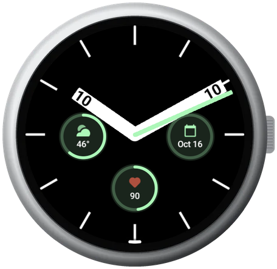
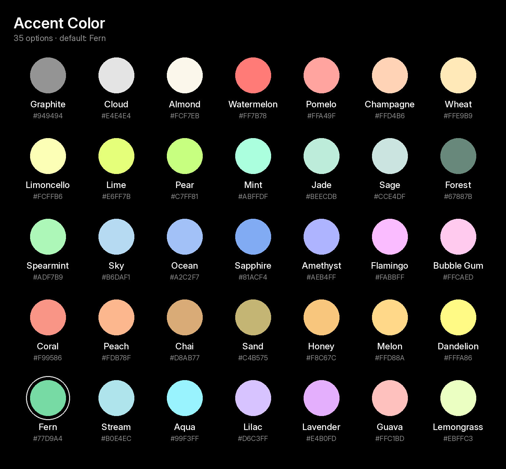
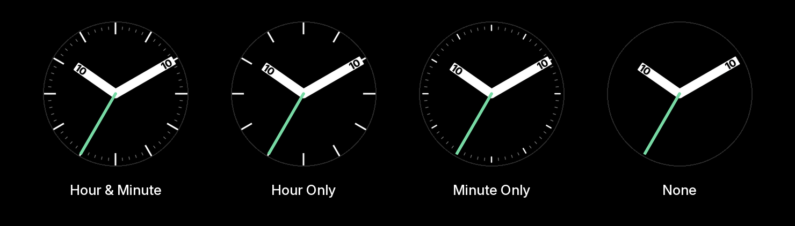

# Digalog

## About
A simple Wear OS watch face that appears analog on the surface, but integrates a digital time on the hour and minute hands for quick reference.

## Preview

## Accent Colors

The 35 colors from Google's own Pixel Watch faces are all available to choose as an accent. The default is Fern. This colors the Seconds hand as well as some Complications.

Chart generated from `watchface.xml` and `strings.xml` by `python3 tools/render_accent_colors.py`.

## Tick Modes
There are 4 different options for the tick marks on the watch face.

Generated from the repo assets by `python3 tools/render_tick_marks.py`.

## Development

### Layout
- `app/src/main/res/raw/watchface.xml`: the whole face (WFF XML)
- `app/src/main/res/xml/watch_face_info.xml`: preview / editable flags
- `app/src/main/res/drawable-nodpi/`: hands, indices, previews
- `app/src/main/AndroidManifest.xml`: `hasCode=false`, `com.google.wear.watchface.format.version=1`

### Build
Requires JDK 17 and the Android SDK (API 35). Open the folder in Android Studio, or:

    ./gradlew assembleDebug        # app/build/outputs/apk/debug/app-debug.apk
    ./gradlew bundleRelease        # AAB for Play (sign with your upload key)

### Install
On a Wear OS 4+ emulator (Device Manager > Wear OS Large/Small Round, API 33+) or a watch with ADB debugging on:

    adb install -r app/build/outputs/apk/debug/app-debug.apk

Then long-press the current watch face, swipe to the end, tap **+**, and pick *Digalog*.
A debug build can't replace the Play-installed copy because the signatures differ. Uninstall the Play version first.

### Validate
Use the validator from https://github.com/google/watchface (`third_party/wff`):

    ./gradlew :specification:validator:executable-jar
    java -jar wff-validator.jar 1 app/src/main/res/raw/watchface.xml

### Releasing
Bump `versionCode` (current: 20000000 / 2.0.0; the last Play release was 10010002) and `versionName` in `app/build.gradle.kts`.

## License

digalog is licensed under the [*GNU General Public License v3.0*](https://choosealicense.com/licenses/lgpl-3.0/). Permissions of this strong copyleft license are conditioned on making available complete source code of licensed works and modifications, which include larger works using a licensed work, under the same license. Copyright and license notices must be preserved. Contributors provide an express grant of patent rights.

For the betterment of the community, we prefer you contribute directly to this project, but you may use your own fork as long as it is public like this project is.

___

     
    <picture>
        <source media="(prefers-color-scheme: dark)" srcset="https://arbitrari.dev/assets/arbitrari-white.png">
        <source media="(prefers-color-scheme: light)" srcset="https://arbitrari.dev/assets/arbitrari-black.png">
        
    </picture>

